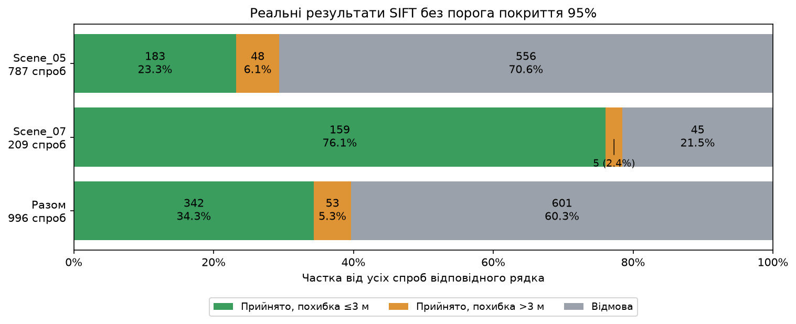
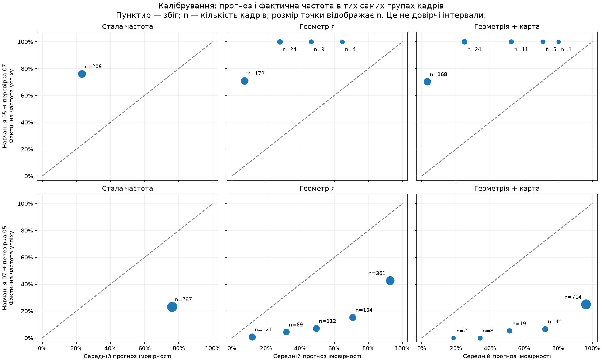

# Як читати всі отримані результати й графіки

Дата пояснення: 2026-10-29. Документ розділяє фактичні результати зіставлення, прогноз моделі та перевірку цього прогнозу. Він не змінює конфігурацію чи результати дослідів. Вихідні JSON/CSV та рисунки в `results/` збережені без перекладу й перерахунку моделей.

## 1. Що саме відбувається

1. **Кадр** — зображення камери. **Сцена** — набір кадрів однієї території з картою та еталонними координатами. Сцена не дорівнює одному кадру.
2. **Аудит** перевіряє наявність даних і можливість геометричної обробки. Придатний для запуску кадр може згодом не локалізуватися.
3. **SIFT** знаходить характерні точки й відповідності між кадром і картою. Після геометричних перевірок повертає координати або відмову. Це локалізатор.
4. Порівняння з **еталоном**, тобто координатами датасету, встановлює, чи правильна прийнята прив’язка. Сам локалізатор цих координат для зіставлення не отримує.
5. Окрема **модель прогнозу** навчається передбачати, чи завершиться майбутня спроба правильною прийнятою прив’язкою. Вона не замінює SIFT і не виправляє його координати.

Три різні величини: похибка координат **у метрах**, прогноз **від 0 до 1**, показники якості прогнозу **без одиниць**. Змішування цих величин створювало плутанину в попередніх поясненнях.

## 2. Умови експерименту: звідки взялися числа

| Налаштування | Що означає | Чого не означає |
| --- | --- | --- |
| 20–120 м | Допустимий діапазон висоти над локальною поверхнею, AGL | Вимогу, доведену для всіх апаратів і камер |
| 0,5 м/піксель | Просторовий масштаб зображень після приведення до зіставлення | Гарантію координатної похибки 0,5 м |
| 20 м на кожну вісь | Стандартне відхилення штучної похибки координат до зіставлення | Виміряну похибку реальної одометрії чи жорсткий радіус |
| 400 м² | Дисперсія на вісь: квадрат 20 м | Похибку 400 м |
| 99% | Маса заданої двовимірної нормальної моделі, за якою будується область пошуку | Успішність зіставлення |
| Приблизно 60,7 м | Радіус круга з цими 99% для ізотропної моделі; пошуковий прямокутник додатково враховує розмір видимої ділянки | Максимально можливу випадкову похибку або межу похибки вихідної прив’язки |
| 95% | Початковий мінімум частки пошукового прямокутника всередині растра | Імовірність успіху або довірчий рівень |
| 3 м | Наш критерій правильної прийнятої прив’язки для навчальної відповіді | Поріг прийняття всередині SIFT чи вимогу безпеки маршруту |
| seed 42 | Число для відтворюваності випадкових операцій та розподілу | Параметр фізичної моделі польоту |

Попередня оцінка положення (`prior`) тут створюється як еталон + випадкова похибка за відомим законом. Вона потрібна, щоб відтворювано випробувати пошук із неточними координатами. Немає висновку, що реальна система матиме саме таку похибку.

**Поріг 95% був попереднім інженерним налаштуванням, а не науково встановленою межею.** У повному досліді `available_crop` він не блокує зіставлення. Наявність `minimum_map_coverage=0.95` в архівній конфігурації не означає, що поріг застосувався: це визначає `coverage_policy`.

Рівень 3 м обрали перед переглядом повного досліду відповідно до рекомендованих авторами AnyVisLoc рівнів 3/5/10 м. Це порівнюваний критерій оцінювання датасету, а не універсальна правильність. Автори уточнювали пози камери та аерофотокарту спільною фотограмметрією: малі відносні похибки не доводять абсолютної сантиметрової точності реального польоту. [Підготовка еталона](https://github.com/UAV-AVL/Benchmark/blob/main/docs/GROUND_TRUTH.md).

## 3. Внутрішні перевірки SIFT

Це окремі пороги, які визначають, чи локалізатор поверне результат. Вони не тотожні нашій подальшій перевірці 3 м.

| Параметр | Значення | Значення для обробки |
| --- | ---: | --- |
| `nfeatures` | 6000 | Орієнтовний бюджет найсильніших точок на кожному зображенні; це не кількість відповідностей і не гарантія точності |
| `ratio_threshold` | 0,75 | Відстань до найсхожішого дескриптора має бути меншою за 0,75 від відстані до другого; відсікає неоднозначні пари |
| `minimum_good_matches` | 12 | Після цієї перевірки потрібно принаймні 12 пар точок |
| `ransac_threshold_px` | 3 пікселі | Допуск для узгодження пар із перетворенням зображень у RANSAC |
| `minimum_inliers` | 8 | Потрібно принаймні 8 геометрично узгоджених пар |
| `minimum_inlier_ratio` | 0,4 | Узгодженими мають бути принаймні 40% попередньо відібраних пар |
| `maximum_median_reprojection_error_px` | 3 пікселі | Медіанна невідповідність перетворених точок має бути не більшою за цей допуск |
| `geometric_R_floor_m` | 0,5 м | Нижній доданок до наближеної матриці `R`; це не підтверджене стандартне відхилення реальної прив’язки |
| `max_image_pixels` | 16000000 | Обмеження пам’яті/обчислень для зображень, а не критерій інформативності місцевості |
| `maximum_projection_condition` | 100 | Інженерне обмеження числової нестійкості проєкції, а не допустимий кут у градусах |

**Відповідність** — пара точок, які вважаються зображенням одного об’єкта. **Дескриптор** — числовий опис околиці точки для пошуку схожості. **Геометрично узгоджена пара**, або `inlier`, підтримує знайдене перетворення в межах допуску. RANSAC шукає таке перетворення, відкидаючи несумісні пари.

Пороги зафіксовані для цього досліду й не доведені як оптимальні. Їх не слід підлаштовувати за остаточною тестовою сценою. Три пікселі на масштабі 0,5 м/піксель не перетворюються автоматично на гарантію координатної похибки 1,5 м: внутрішня узгодженість неправильних пар можлива.

## 4. Чому кількості кадрів різні

| Сцена | Прочитано | Можна запустити за геометричними перевірками | Проходять старі 95% | Роль |
| --- | ---: | ---: | ---: | --- |
| Scene_05 | 1118 | 787 | 147 | Робоча |
| Scene_07 | 1219 | 209 | 205 | Робоча |
| Scene_21 | 1161 | 1082 | 978 | Остаточний тест |

1118+1219+1161=3498 перевірених записів. 787+209=996 фактично виконаних спроб SIFT. Число 1082 для Scene_21 є результатом аудиту, а не кількістю перевірених прив’язок. У Scene_07 1006 кадрів виключені через висоту понад 120 м, а не через доведену непридатність текстури.

`Holdout` — відкладена сцена для остаточної перевірки після завершення розроблення моделі. Тому її зображення й геометрію перевіряли, але результати зіставлення не переглядали. Це не ще одна навчальна сцена.

## 5. Що реально зробив локалізатор

| Сцена | Усі спроби | Прийнято | Прийнято до 3 м | Прийнято понад 3 м | Відмов |
| --- | ---: | ---: | ---: | ---: | ---: |
| Scene_05 | 787 | 231 | 183 | 48 | 556 |
| Scene_07 | 209 | 164 | 159 | 5 | 45 |
| Разом | 996 | 395 | 342 | 53 | 601 |

Горизонтальна похибка: `sqrt((x_est-x_GT)^2 + (y_est-y_GT)^2)`. Висота не входить у цей показник. Якщо локалізатор відмовився, координатної похибки немає; відмова не записується як нуль метрів.

Три відсотки з різними знаменниками:

- **39,66% = 395/996**: як часто SIFT щось прийняв.
- **34,34% = 342/996**: як часто спроба завершилася прийнятою прив’язкою до 3 м.
- **86,58% = 342/395**: яка частина вже прийнятих прив’язок уклалася в 3 м. Решта **13,42% = 53/395** — прийняті понад 3 м. Це не частка від усіх спроб.

Scene_05: успіх 183/787=23,25%. Scene_07: 159/209=76,08%. Це результати SIFT, а не точність навченої моделі. Порівнюємо відібрані за поточними умовами частини сцен, а не всі польоти.

Причини відмов Scene_05: 272 недостатні відповідності та 284 недостатня кількість/частка узгоджених пар. Scene_07: відповідно 37 і 8. «Недостатньо узгоджених» не означає, що обов’язково мало всіх знайдених точок.

Видима ділянка частково виходить за растр у 558/787 випадках Scene_05 і 4/209 Scene_07. На Scene_05 успіх для повністю вкладених ділянок — 111/229=48,47%, для частково зовнішніх — 72/558=12,90%. Відмінність узгоджується з роллю перекриття, але не доводить, що всі інші умови однакові. Навіть повністю вкладена ділянка може містити чорне заповнення чи неоднозначну текстуру.

## 6. Інші рівні похибки, медіана, середнє й великі помилки

`Acc@t` = прийняті з похибкою ≤t / усі спроби. Для 996 спроб:

| Рівень | Кількість | Частка |
| --- | ---: | ---: |
| 1 м | 293 | 29,42% |
| 3 м | 342 | 34,34% |
| 5 м | 358 | 35,94% |
| 10 м | 374 | 37,55% |
| 20 м | 379 | 38,05% |

Послаблення критерію від 3 до 5 м змінить навчальні відповіді для 16 прийнятих спроб; відмови не стануть успіхами. Не слід вибирати рівень лише тому, що на ньому красивіші числа. Якщо є прикладна вимога до точності — її обґрунтовують окремо.

Статистика **лише 395 прийнятих похибок**: мінімум 0,01095 м; медіана 0,3186 м; середнє 6,0584 м; максимум 432,3124 м; RMSE 37,8356 м.

- Медіана — середина відсортованого списку; близько половини прийнятих похибок менші.
- Середнє враховує всі значення; кілька дуже великих похибок помітно його підвищують.
- RMSE — корінь із середнього квадратів похибок; ще сильніше реагує на великі помилки.

Тому медіана 0,32 м й максимум 432 м не суперечать одне одному. Мала типова похибка прийнятих прив’язок не виключає небезпечних великих помилок або численних відмов.

Конкретний приклад: `Scene_05/L05_0712.npz`. Прийнято з 16 попередньо відібраними парами, 8 узгодженими (50%), медіаною перепроєкції 0,552 пікселя; фактична координатна похибка — 432,31 м. Усі ці числа збережено в одній спробі. Вони показують, що внутрішні пороги пропускають неправильні координати. Код застосовує знайдене проєктивне перетворення до опорної точки й не містить окремої перевірки правдоподібності вихідної позиції щодо попередньої. Це пояснює, чому радіус пошуку не є жорсткою межею похибки результату; точну фізичну причину цього зіставлення ще не встановлено.

`R` — наближена матриця невизначеності XY. Вона обчислена за залишками узгоджених пар і нижнім доданком, а не навчена за реальними координатними похибками. У наведеному неправильному випадку її діагональ близька до 0,26 і 0,28 м² попри похибку 432 м. Тому `R_calibrated=false` має суттєве значення: малу `R` не можна трактувати як доказ правильності.

## 7. Що дало вимкнення 95%

| Показник на тих самих 996 спробах | Старий поріг | Без порога |
| --- | ---: | ---: |
| Прийнято до 3 м | 234 | 342 |
| Прийнято понад 3 м | 7 | 53 |
| Відмов | 755 | 601 |
| Частка прийнятих понад 3 м серед прийнятих | 2,90% | 13,42% |

Додано 108 правильних за критерієм 3 м і 46 неточних прийнятих прив’язок. Старий режим отримано повторним застосуванням перевірки до збережених результатів, а не другим незалежним запуском. Перший вибраний контроль 16 відмов дав усі 16 прийнятих із похибками 0,0401–0,6444 м, медіана 0,1440 м. Цей малий набір був нерепрезентативним для всіх випадків низького покриття.

## 8. Що прогнозує модель і чим відрізняються варіанти

Навчальна відповідь `y=1`: прийнято й похибка ≤3 м. `y=0`: відмова або прийнято з похибкою >3 м. Прогноз `p=0.7` означає заяву моделі про 70% імовірності цієї події за даних умов. Це не координата, не виміряна частота окремого кадру й не твердження, що вже зроблена прив’язка має похибку 0,7 м.

- `constant`: усім кадрам однакова частота успіху навчальних даних. Жодного опису кадру не використовує.
- `geometry`: сім геометричних ознак подаються в логістичну регресію. Це статистична модель ймовірності.
- `geometry_and_map_features`: ті самі сім плюс щільність SIFT-точок карти.

Сім ознак: висота над поверхнею, частка пошукового прямокутника в межах растра, відношення площ потрібного пошуку й видимої ділянки, показник числової стійкості проєкції, площа видимої ділянки, кількість пікселів прямокутника перетвореного кадру, кількість пікселів фрагмента карти. Назви з `log_` означають натуральний логарифм величини; це перетворення для масштабу, а не додатковий фізичний показник. Щільність карти обчислена як `log(1 + 1000000 * кількість_точок / кількість_пікселів)`.

Для регресій ознаки відцентровані й поділені на навчальне стандартне відхилення. Коефіцієнт у JSON описує внесок такої масштабованої ознаки до внутрішньої суми, а не відсоток успіху. Вільний зсув — `intercept`. Регуляризація 1 стримує коефіцієнти; кількість кроків оптимізатора — обчислювальна діагностика. Поле `objective` містить сумарну навчальну втрату з регуляризацією; воно не тотожне середній перевірочній `log_loss` й не порівнюється напряму між різними розмірами навчання.

## 9. Як оцінюємо прогноз

**Логарифмічна втрата, `log_loss`.** Якщо успіх стався, штраф `-ln(p)`; якщо ні — `-ln(1-p)`. Після цього усереднюємо всі кадри. Чим менше, тим краще; 0 — ідеальна границя. Верхньої межі 1 немає. Упевнена помилка штрафується особливо сильно.

| Прогноз p | Фактичний результат | Штраф |
| --- | --- | ---: |
| 90% | Успіх | 0,105 |
| 50% | Успіх | 0,693 |
| 10% | Успіх | 2,303 |
| 90% | Невдача | 2,303 |

**Brier score.** Середнє `(p-y)^2`. Для двох класів у нашому коді лежить від 0 до 1; менше краще. Прогноз 90% при успіху дає 0,01, при невдачі — 0,81. Значення 0,33 не означає 33% неправильних кадрів. Обидві втрати оцінюють ймовірнісний прогноз загалом, а не лише калібрування.

**ROC AUC.** Частка пар «успішна спроба — неуспішна», для яких модель поставила успішну вище, з половиною внеску для рівних оцінок. 0,5 — відсутність розділення цим порядком, 1 — ідеальний порядок. AUC 0,873 не означає 87,3% точності. Можна дати всім успіхам 10%, усім невдачам 1%: порядок чудовий, імовірності погані.

Ці визначення стандартні; вони не є довільними критеріями, вигаданими для цього досліду. Вибір головною саме ймовірнісної втрати пов’язаний із бажаним використанням числових імовірностей у плануванні. [Визначення метрик](https://scikit-learn.org/stable/modules/model_evaluation.html), [логарифмічна втрата](https://scikit-learn.org/stable/modules/generated/sklearn.metrics.log_loss.html), [Brier](https://scikit-learn.org/stable/modules/generated/sklearn.metrics.brier_score_loss.html), [AUC](https://scikit-learn.org/stable/modules/generated/sklearn.metrics.roc_auc_score.html).

## 10. Обидва отримані результати

У таблиці «Факт» — частка успішних спроб SIFT на перевірочній сцені, однакова для всіх моделей цієї сцени. «Прогноз» — середнє їхніх індивідуальних прогнозів, а не точність моделі.

| Навчання → перевірка | Модель | Прогноз | Факт | Log loss ↓ | Brier ↓ | AUC ↑ |
| --- | --- | ---: | ---: | ---: | ---: | ---: |
| 05 → 07 | Стала | 23.25% | 76.08% | 1.1731 | 0.4610 | 0.5000 |
| 05 → 07 | Геометрія | 12.54% | 76.08% | 1.7399 | 0.5647 | 0.8164 |
| 05 → 07 | Геометрія + карта | 10.34% | 76.08% | 2.3346 | 0.5981 | 0.8730 |
| 07 → 05 | Стала | 76.08% | 23.25% | 1.1613 | 0.4575 | 0.5000 |
| 07 → 05 | Геометрія | 64.27% | 23.25% | 1.1119 | 0.3324 | 0.7982 |
| 07 → 05 | Геометрія + карта | 93.03% | 23.25% | 2.7555 | 0.6607 | 0.6716 |

У першому напрямку моделі занижують успіх, у другому завищують. Середні 10,34% і 93,03% — прогнози, не частоти правильності SIFT. Сама відповідність середнього прогнозу загальній частоті теж недостатня: окремі групи можуть мати протилежні помилки, що компенсуються.

Для масштабу, **незмінний прогноз 50% кожній спробі** має `log_loss=ln(2)=0,6931`, `Brier=0,25`, `AUC=0,5` на обох сценах. Усі шість наших перевірочних варіантів гірші за цей орієнтир за обома втратами. Це пояснювальне порівняння після досліду, не нова навчена модель чи доведений переможець остаточного тесту. Попереднє «геометрія трохи краща за сталу» у зворотному напрямку було правильним, але неповним без цього масштабу.

Приріст від карти у звіті визначено як `втрата_геометрії - втрата_геометрії_з_картою`. У першому напрямку -0,5947, у зворотному -1,6435. Від’ємне значення означає погіршення. Це не відсотки й не метри.

`outside_training_feature_ranges_count`: хоча б одна ознака виходить за мінімум/максимум навчальної сцени. Геометрія: 55/209 у першому напрямку, 537/787 у зворотному. З картою: 153/209 і 559/787. Це попередження про відмінність умов, не кількість неправильних прогнозів. У сталої 0, бо вона не має ознак; це не підтвердження застосовності. Навіть усі ознаки всередині окремих діапазонів не гарантують підтримуваності їхнього поєднання.

## 11. Як читати графіки калібрування

Калібрування означає відповідність ймовірності частоті: серед багатьох спроб із прогнозом близько 70% має бути близько 70% успіхів. Йдеться про групи, а не перевірку ймовірності одного випадку. [Пояснення калібрування](https://scikit-learn.org/stable/modules/calibration.html).

У початкових `calibration.png` горизонтальна вісь — середня прогнозована ймовірність у групі, вертикальна — фактична частота успіху тієї самої групи. Пунктир `y=x` означає збіг. Точка вище пунктиру — модель занижує успіх, нижче — завищує.

Перед побудовою прогнози розбиваються на п’ять інтервалів: 0–20%, 20–40%, 40–60%, 60–80%, 80–100%. Порожні групи пропускаються. Це спосіб показу, а не п’ять моделей чи пороги прийняття. З’єднувальні відрізки в старому рисунку лише допомагають простежити колір; не є законом, часовою траєкторією або довірчими межами. Синя лінія має одну точку, бо стала модель усім дала той самий прогноз.

Новий рисунок показує ті самі збережені групи окремо для кожної моделі, у відсотках і з кількістю кадрів `n`. Моделі не перенавчалися. Розмір точки показує кількість спостережень, а не статистичну надійність. Довірчих інтервалів немає.

Конкретні точки:

- Перший напрямок, стала: `(23,25%; 76,08%)`, n=209. Усім дали 23,25%, а успіхів було 76,08%.
- Перший напрямок, карта, група найнижчих прогнозів: `(3,26%; 70,24%)`, n=168. Дуже сильне заниження.
- Зворотний напрямок, карта, група найвищих прогнозів: `(96,28%; 25,07%)`, n=714. Дуже сильне завищення.
- Зворотний напрямок, геометрія, найвища група: `(92,64%; 42,66%)`, n=361. Навіть цей кращий за сталою втратою варіант надмірно впевнений.

Точки на висоті 100% у першому рисунку не доводять ідеальної моделі: деякі містять лише 1, 4 чи 5 кадрів. Групова частота 1/1=100% арифметично правильна, але слабка для узагальнення. Сусідні кадри додатково залежні. Графік калібрування не є ROC-кривою; AUC обчислюється за всіма індивідуальними прогнозами, а не як площа під цим рисунком.

## 12. Геометричні рисунки аудиту

У `geometry-*.png` осі `East, m` і `North, m` — східна та північна координати в метрах у локальній системі сцени. Від’ємна північна координата не є помилкою: це положення південніше початку координат.

- Зелений полігон `Actual footprint` — ділянка, видима камерою за еталонним положенням і поточною моделлю поверхні.
- Бірюзовий прямокутник `Search at GT` — потрібний пошук навколо еталонних координат із незмінною невизначеністю.
- Помаранчевий `Search at prior` — пошук навколо конкретної попередньої оцінки.
- Зелений плюс `GT` — еталон; помаранчевий хрест `Prior` — попередня оцінка.

Три покриття: `footprint_coverage` — частка зеленого полігона в межах растра; `gt_search_coverage` — частка бірюзового прямокутника; `prior_search_coverage` — частка помаранчевого. Наприклад, видима ділянка може бути повністю всередині, але великий прямокутник пошуку виходити назовні: це нестача запасу карти, а не автоматично погана текстура. Назва `covered` у рисунку не є статусом успіху SIFT.

У `map-inspection.png` ліворуч звичайний огляд карти, праворуч пурпуром позначені майже чорні/білі пікселі. Це індикатор для огляду, а не підтверджена маска відсутніх даних. Геометричне покриття прямокутного растра може бути 100%, навіть якщо всередині є чорне заповнення.

## 13. Що означають статуси та які файли відкривати

| Назва | Пояснення |
| --- | --- |
| `accepted_xy_uncalibrated` | Локалізатор прийняв XY; оцінка `R` не калібрована; правильність за еталоном перевіряється окремо |
| `validation_passed=false` | Позитивну остаточну перевірку не підтверджено; це не повідомлення про падіння програми |
| `final_test_evaluated=false` | Scene_21 ще не використана для остаточного оцінювання |
| `research_only` / `diagnostic_only` | Дослідний або діагностичний результат |
| `target_platform_calibrated=false` | Немає підтвердження для конкретного бортового обладнання |
| `selected_by_validation=constant` | Стала найменш погана серед трьох за заданим критерієм першого напрямку; це не сертифікація якості |
| `selected_by_validation=null` у зворотному | Там навмисно не робили нового остаточного вибору |
| `final_refit_count=996` | Після першого порівняння моделі повторно навчені на обох робочих сценах; наведені перевірочні метрики до них не належать |

`validation_models/` містить моделі лише Scene_05 для першого порівняння. `frozen_models/` — повторне навчання на обох сценах; стала там 342/996=34,34%. `evaluation_models/` зворотного досліду — навчання лише на Scene_07. Змішувати метрики цих наборів не можна.

`summary.json` — зведені числа. `validation_predictions.csv` / `evaluation_predictions.csv` — прогноз кожної моделі для кожної спроби. `calibration.csv` — точні координати точок і кількості на рисунку. `manifest.json` — метадані й контрольні суми. SHA-256 перевіряє незмінність байтів; він не доводить наукової правильності. Час Colab характеризує той запуск, а не бортову продуктивність.

## 14. Межа наукового висновку

Поріг 95%, критерій 3 м, 99% пошуку, 40% узгоджених пар, стандартне відхилення 20 м і AUC 0,8 описують різні речі. Для кожного потрібно вказувати одиниці, знаменник і роль: умова досліду, внутрішня перевірка, правило навчальної відповіді чи метрика.

Підтверджено: вимкнення порога збільшило і правильні прив’язки, і неточні прийняття; поточні моделі погано переносять ймовірності між двома територіями; поточна щільність точок карти погіршила обидві ймовірнісні перевірки. Не підтверджено: непридатність усієї візуальної корекції, користь ще не реалізованого нового опису, польотні частоти, безпека маршруту чи узагальнення на невідому територію.

Початковий розширений план містить ще п’ятигрупову перевірку, 95% статистичні інтервали, рівень тесту 0,05 й суміш похибок. Це заплановані майбутні процедури, не отримані поточні числа. Відсутність статистичного відхилення гіпотези не доводить безпеки; довільне «п’ять сцен» теж не є універсально достатньою вибіркою. Нинішня оцінка обмежена двома робочими сценами; третю відкладено для завершального тесту.
