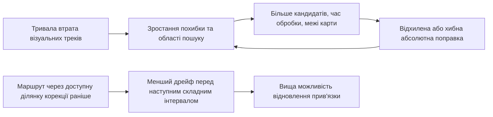

# Планування маршруту БПС без ГНСС: аналоги та програма наукової новизни

Дата огляду: 27 жовтня 2026 року. Об'єкт: попереднє планування маршруту мультироторного БПС для доставки в задану зону за відсутності ГНСС. Джерела: фактичний код і документи репозиторію, первинні публікації та авторські матеріали.

Це дослідницька пропозиція, а не звіт про вже доведену перевагу нового алгоритму. Нижче окремо позначено відомі результати, власні аналітичні ілюстрації та гіпотези для перевірки. Цільовий пошук літератури не є вичерпним систематичним оглядом і не доводить світового пріоритету. Формулювання «вперше» до реалізації, порівняння з найближчими аналогами та повторного бібліографічного пошуку буде передчасним.

## 1. Рекомендований науковий напрям

**Метод попереднього планування маршруту БПС з урахуванням можливості відновлення абсолютної локалізації за обмежених ресурсів, історії навігаційних вимірювань та контрольованої похибки прогнозу успішного прибуття.**

Важлива властивість маршруту — не лише кількість інформативних ділянок, а те, чи залишатиметься навігаційний стан придатним для використання наступної корекції. Одна й та сама ділянка карти може бути корисною після короткого дрейфу та практично недоступною для прив'язки після довгого: область пошуку зростає, карта має межі, з'являються схожі місця, а matcher має обмеження пам'яті й часу.

Пропонується одна узгоджена програма з трьома внесками:

1. **Модель відновлення локалізації:** умовні переходи між правильною прив'язкою, відмовою й хибною прив'язкою з урахуванням області пошуку, ресурсного бюджету та тривалості несприятливих епізодів.
2. **Модель рельєфної спостережуваності:** оцінювання послідовності вимірювань із відокремленням горизонтальної інформації від похибки висоти та неоднозначності рельєфу; прогноз взаємодоповнення VML і TAN.
3. **Алгоритм пошуку:** багатомітковий пошук на растрі з адаптивним уточненням навігаційного стану та явним обліком похибки його спрощення.

Перший внесок — пріоритет для найближчої статті; другий — фізично обґрунтоване розширення; третій — найбільш складна алгоритмічна частина дисертації. Просте поєднання готових фільтрів і MOA* саме по собі не становить достатньої новизни.

## 2. Фактична вихідна база репозиторію

Опис «scripts/ порожній, реалізації немає» в AGENTS.md не відповідає поточним файлам. Код уже існує, але повна стохастична навігаційна система ще не реалізована.

| Компонент | Фактично наявне | Наукове обмеження |
| --- | --- | --- |
| [nav_quality.py](../../../scripts/pipeline/nav_quality.py) | Shi–Tomasi, ентропія NDVI/RGB, slope/TRI/TPI/std/roughness | Це індикатори структури зображення й рельєфу, а не калібровані ймовірності правильної локалізації |
| [cell_vectors.py](../../../scripts/pipeline/cell_vectors.py) | `nav_density = maximum(phi_vis, phi_ter)` | Максимум двох балів не моделює злиття сенсорів, кореляцію або різні напрямки їхньої інформації |
| [edge_costs.py](../../../scripts/moa/edge_costs.py) | Критерії `t`, `(1-nav)*t`, `(1-visibility)*t`; геометричні та інші перевірки | Адитивні дефіцити не визначають імовірність фактичного прибуття; порядок ділянок з однаковими сумами втрачається |
| [moa_star.py](../../../scripts/moa/moa_star.py) | EMOA*-Late-BS; стан комірки, за потреби напрямок входу | Поточна мітка не переносить багатомодальний навігаційний стан або TAN-історію |
| [benchmark](../../../scripts/benchmark/README.md) | A* за часом, повторний weighted A*, EMOA*, oracle на малих задачах, статистичний аналіз | Це корисна база перевірки пошуку, але результати старих критеріїв не підтверджують реальну навігаційну надійність |
| [chance_constrained](../../../scripts/pipeline/chance_constrained/README.md) | Сцена, орієнтовані ребра, режими, часткове ребро входу до зони | Немає завершеного спільного переходу INS/VIO + VML + TAN та оцінювача успіху маршруту |
| [propagation](../../../scripts/pipeline/chance_constrained/propagation/README.md) | Код підготовки та використання умовних моделей INS/OpenVINS | Наявність коду не означає наявність перевіреного outdoor-артефакту для конкретного БПС |
| [VML status](../../../docs/vml_increment_status.md) | Реальні кадри AnyVisLoc у smoke-перевірці | Немає навченої та міжсценово валідованої моделі; `validation_passed=false` |

За збереженим звітом VML від 22.10.2026: 20 кадрів Scene_05, по 20 випробувань для aerial і satellite; прийнято 4 та 0 відповідно. По 16 відмов у кожному режимі пов'язані з покриттям карти. Prior синтетичний; `R` не калібрована. Це свідчить про працездатність окремих гілок обробки, а не про польотні ймовірності 0,2 або 0.

У [постановці доставки](delivery_mission_path_planning_problem.md), [плані навігаційної моделі](navigation_quality_implementation_plan.md) та [багатокритеріальному варіанті](multi_objective_navigation_aware_path_planning.md) уже описано belief-стан, хибні VML-поправки, залежність від історії, доступність майбутньої корекції та нижню оцінку ймовірності успіху. Їх не слід видавати за нові ідеї цього огляду. Потрібний наступний рівень: конкретна модель, обчислюваний алгоритм, умови його коректності та незалежне підтвердження.

У документах співіснують дві постановки. Для термінової доставки рекомендовано основну: мінімальний час за заданої вимоги надійності. Парето-фронт «час — ризик» корисний для дослідження компромісів. У цьому огляді не змінюється вибір растрового пошуку на RRT*; sampling-based методи розглядаються як наукові аналоги.

## 3. Що вже зроблено іншими дослідниками

Таблиця описує конкретний перевірений внесок джерела. Відсутність якоїсь властивості в короткому описі не означає доведеної відсутності в усіх роботах відповідної групи.

| Робота / сімейство | Відомий результат | Наслідок для нашої новизни |
| --- | --- | --- |
| Bry, Roy, **RRBT**, ICRA 2011 | Планування в просторі розподілів стану, просторово залежні вимірювання, обмеження ймовірності зіткнення. [Авторський запис і рукопис](https://dspace.mit.edu/entities/publication/7344b7ca-5725-45ab-b6d1-7476a0afca15) | «Врахувати коваріацію в плануванні» вже відомо |
| Bopardikar, Englot, Speranzon, **Robust Belief Roadmap**, препринт 2013 / ICRA 2014 | Пропуски вимірювань і межі похибки оцінювача включено у вибір маршруту. [Авторський текст](https://albspe.github.io/publications/ICRA14-01.pdf) | «Додати імовірність відмови камери» недостатньо |
| Pathak, Thomas, Indelman, **DA-BSP**, IJRR 2018 | Неоднозначні відповідності, Gaussian mixtures, активне розрізнення гіпотез. [Стаття](https://indelman.github.io/ANPL-Website/Publications/Pathak18ijrr.pdf) | «Врахувати хибні зіставлення або багатомодальність» уже відомо |
| Zhang, Scaramuzza, **Fisher Information Field**, 2020 | Попередньо обчислювана інформаційна карта для швидкого оцінювання візуальної локалізації. [Препринт](https://arxiv.org/abs/2008.03324) | Заміна щільності ознак на Fisher information сама по собі не нова |
| Kim et al., **Topology-Guided Path Planning**, IROS 2021 | Вибір топологічного класу з корисною візуальною інформацією та подальший графовий пошук. [Стаття](https://arxiv.org/abs/2107.08616) | Ієрархія «коридори → детальний шлях» також має аналоги |
| Takemura, Aoki, Ishigami, **Energy-and-perception-aware planning**, 2023 | Глобальне планування енергії у просторово-часовому вітрі, локальне підтримання якості LiDAR-сприйняття. [Стаття](https://doi.org/10.1177/16878132231169688) | Поєднання енергії, вітру та сприйняття вже реалізоване |
| Takemura, Ishigami, **Perception-and-Energy-aware Motion Planning**, препринт 2023 | Навчання залежних від швидкості моделей енергії та гетероскедастичної невизначеності LiDAR. [Препринт](https://arxiv.org/abs/2309.14272) | Саме навчання якості сенсора або оптимізація швидкості не є достатнім внеском |
| Ren et al., **EMOA***, Artificial Intelligence 339, 2025; DOI 2024 | Ефективні перевірки домінування для адитивної багатокритеріальної задачі. [Стаття](https://doi.org/10.1016/j.artint.2024.104260) | Реалізація EMOA* — відтворення відомого алгоритму; його гарантії не переносяться автоматично на залежну від belief надійність |
| Fuentes et al., **BRULE**, 2025 | Belief roadmap із можливим зникненням орієнтирів, сумішами розподілів та обмеженням їхньої складності. [Повний текст](https://arxiv.org/html/2501.17982v1) | «Застарівання карти» і «скорочення кількості гіпотез» мають близькі аналоги |
| Zhitnikov, Indelman, **Simplified Continuous High-Dimensional BSP**, T-RO 2024 | Спрощення belief-space планування з імовірнісними belief-dependent обмеженнями. [Стаття](https://anpl-technion.github.io/Publications/Zhitnikov24tro.pdf) | Адаптивне уточнення з межами — відома методологія; потрібна предметна відмінність |
| Zhitnikov, Indelman, **Anytime Probabilistically Constrained…**, T-RO 2025 | Онлайн-пошук MCTS з обмеженнями, що залежать від belief, і гарантіями у визначених авторами умовах. [Стаття](https://doi.org/10.1109/TRO.2025.3610176) | Загальна фраза «надійне планування під невизначеністю» вже охоплена сильними роботами |
| de Groot et al., **Safe Horizon MPC**, IJRR 2025 | Спільне обмеження ймовірності зіткнення на горизонті з використанням сценаріїв. [Стаття](https://doi.org/10.1177/02783649251315203) | Маршрутний ризик замість окремих локальних ризиків не є новим сам по собі |
| Poissant et al., **ARENA**, препринт 2025 | Багатокритеріальна адаптація траєкторії за безпекою, часом і енергією. [Препринт](https://arxiv.org/abs/2502.19401) | «Адаптивні ваги» та «ризик + енергія + час» мають прямі аналоги |
| Qin et al., **Perception-Aware Time-Optimal Planning**, препринт 2026 | Мінімізація часу з візуальними вимогами та нелінійною динамікою квадрокоптера. [Препринт](https://arxiv.org/abs/2603.04305) | Навіть формула «мінімальний час з урахуванням сприйняття» не є новою |
| Zhai, Reiter, Scaramuzza, **PA-MPPI**, RA-L 2026 | Планування/керування з урахуванням невідомих областей простору. [Стаття](https://doi.org/10.1109/LRA.2026.3662653) | Це важливий аналог для локального керування; його perception objective не слід ототожнювати з ризиком хибної глобальної прив'язки |

Окремо слід врахувати роботи з TAN поза авіацією. У **An AUV localization and path planning algorithm for terrain-aided navigation** використано рельєфну складність у переходах і particle filter у плануванні; автори прямо обговорюють недоліки оптимізації лише сумарної складності рельєфу. Це близький методичний аналог незалежно від типу платформи. [Первинне джерело](https://www.sciencedirect.com/science/article/pii/S0019057820301609).

У **A Robust Terrain Aided Navigation Using the Rao-Blackwellized Particle Filter Trained by Long Short-Term Memory Networks** розглянуто деградацію на плоских і повторюваних ділянках. Тому «розпізнати неінформативний рельєф» теж не нова проблема. [Стаття, 2018](https://www.mdpi.com/1424-8220/18/9/2886).

Додатковий близький кандидат для поглибленого аналізу — **Three-Dimensional Near-Seabed Path Planning… Using Fisher Information…**, 2026. Доступні індексовані матеріали видавця описують інформаційний Hybrid A* та TAN-EKF перевірку; пряме відкриття повного тексту під час огляду повернуло HTTP 429. Тому відмінності на рівні рівнянь цієї роботи тут не стверджуються. [Сторінка видавця](https://www.mdpi.com/2077-1312/14/14/1312).

## 4. Внесок 1: планування за можливістю відновлення локалізації

### 4.1. Конкретна проблема

Статичний бал місцевості не відповідає на питання, чи зможе конкретний локалізатор виконати наступну корекцію за поточного дрейфу. Негативний зворотний зв'язок такий:

Планувальник має обирати послідовність ділянок так, щоб не втрачати можливість майбутнього відновлення. Це не вимога завжди летіти над максимально текстурованою поверхнею.

### 4.2. Математичний об'єкт

Позначимо `a` просторове ребро та режим його проходження; `c` — зафіксовану конфігурацію локалізатора: GSD, період запуску, правило приймання, обсяг пошуку, ліміт часу/пам'яті. У першому експерименті `c` не оптимізується, а є однаковою для всіх методів.

Необхідно розрізняти бортовий стан `b` та прогнозний розподіл `ξ` за справжнім станом, бортовою оцінкою, режимом і потрібною історією. Це особливо важливо після хибного match: мала бортова коваріація не означає малу справжню похибку.

Шуканий оператор:

\[
K_{a,c}:\xi_k\longmapsto
\mathcal L(X_{k+1},\hat X_{k+1},b_{k+1},m_{k+1},h_{k+1},s_{k+1}).
\]

`s` містить статус виконання/порушення обмежень; `h` — фазу VML, TAN-вікно та змінні, потрібні для відтворення кореляцій. Оператор має коректно розділяти `local`, `reject`, `gross`; тайм-аут належить `reject`. Параметри беруться з вимірювань та явно відокремлених сценарних припущень.

Для однієї VML-спроби, за фіксованого бортового prior `b`, нехай `S_c(b)` — множина справжніх положень, з яких правильна прив'язка геометрично доступна реалізованому пошуку. Тоді

\[
p_{\rm local}=\int_{S_c(b)}q_{\rm local}(x,b,c,\nu)\,d\xi(x\mid b),
\qquad
p_{\rm local}\leq \xi(S_c(b)\mid b).
\]

Тут `q_local` включає зіставлення, геометричну перевірку й завершення в межах бюджету, а `ν` — умови середовища. `S_c` визначається геометрією matcher-а та кадру; його не можна без перевірки ототожнювати з прямокутником crop. Нерівність — елементарний наслідок моделі, а не самостійна нова теорема.

Можна визначити **множину станів відновлення** для ребра:

\[
\mathcal R_{a,c}(\eta)=
\{\xi:\inf_{K\in\mathcal U_{a,c}}
\Pr_K(\text{коректне відновлення до кінця ребра без порушення обмежень}\mid\xi)
\geq\eta\}.
\]

`U` — обґрунтована множина невизначених моделей. Локальна множина допомагає відсіюванню/евристиці, але не підміняє спільну ймовірність успіху цілого маршруту. Велика коваріація не завжди незворотна: надійна глобальна retrieval-процедура змінить `S_c` і, відповідно, весь оператор.

### 4.3. Ілюстрація механізму

Для суто ілюстративної ізотропної правильно центрованої похибки `N(0,σ²I)` та круглої області захоплення радіуса `r`:

\[
p_{\rm capture}=1-\exp[-r^2/(2\sigma^2)].
\]

При довільно вибраному `r = 30 м` маємо 0,989 для `σ = 10 м` та 0,245 для `σ = 40 м`. Це **не результати проєкту** і навіть не ймовірність правильного match: лише геометрична ілюстрація. Якість тієї самої карти не змінилася, а доступність корекції змінилася суттєво. За biased prior потрібний інший розрахунок.

### 4.4. Що має бути новим відносно аналогів

RRBT уже враховує залежність вимірювань від стану; Robust BRM — пропуски; DA-BSP — неоднозначність; BRULE — зміни карти. У BRULE, зокрема, розглянуто ідеалізований детектор орієнтирів у межах дальності, а постановка зосереджена на невизначеності в цілі. [Розділи II-B–II-D](https://arxiv.org/html/2501.17982v1).

Наш кандидат на відмінність — **ідентифікований за реальним локалізатором оператор із кінцевою областю пошуку та ресурсними відмовами, який відображає залежність від попереднього дрейфу й використовується у растровому плануванні фактичного прибуття**. Треба продемонструвати, що ця залежність змінює рішення і дає перевагу навіть порівняно з belief-планувальником, який уже має пропуски й хибні зіставлення, але використовує спрощену область доступності корекції.

Саме навчання класифікатора `local/reject/gross` без такого результату — корисний компонент, але слабка основа для окремої дисертаційної новизни.

### 4.5. Очікуваний ефект та спростування

Можливе підвищення частки фактичних прибуттів за однакового часу або зменшення часу за однакової підтвердженої надійності. Причина — завчасна корекція перед довгим несприятливим відрізком і уникнення «обіцяних», але недоступних корекцій. Додаткові метрики: частота незворотної втрати прив'язки, gross-помилок, пропусків дедлайну, передчасного оголошення прибуття.

Гіпотезу слід відхилити або звузити, якщо моделювання capture/resource dependence не покращує held-out прогноз і маршрутні результати відносно сильного belief-baseline. За повного покриття карти, малого дрейфу й великого бюджету ефект закономірно може бути нульовим.

Корельовані відмови потрібно моделювати епізодами або латентними станами з тривалістю. Проте сама наявність кореляції не означає, що незалежна модель завжди завищує чи завжди занижує успіх: напрямок похибки залежить від події, потрібної для місії. Перевіряється саме прогноз довгих інтервалів без корекції та кінцевого успіху.

## 5. Внесок 2: рельєфна спостережуваність послідовності та взаємодоповнення сенсорів

### 5.1. Чому roughness недостатньо

Великий перепад висот не гарантує визначення двох горизонтальних координат. Рівномірний схил може містити інформацію лише в одному напрямку; повторювані гряди можуть створювати декілька однаково правдоподібних положень. Невідоме зміщення висотного каналу може додатково пояснювати ту саму зміну дальності, що й горизонтальне зміщення.

Репозиторний план уже передбачає point-mass TAN за профілем. Новий внесок має полягати в **обчислюваному наближенні цього профілю для пошуку**, яке зберігає суттєву інформацію про bias, напрямки похибки й альтернативні гіпотези, а не в повторному описі TAN.

### 5.2. Локальна модель як основа швидкого прогнозу

Для короткого вікна з майже сталим горизонтальним зсувом `δp` та спільним зміщенням висоти `β` лінеаризована модель залишків має вигляд

\[
z_j\simeq-\nabla h(p_j)^T\delta p+\beta+\epsilon_j.
\]

Позначимо матрицю градієнтів через `G`, коваріацію шуму вікна через `C`, `W=C^{-1}`, а апріорну дисперсію bias — `σ_β²`. Після виключення nuisance-параметра `β` ефективна горизонтальна інформація:

\[
J_{xy}=G^TWG-
G^TW\mathbf1
(\mathbf1^TW\mathbf1+\sigma_\beta^{-2})^{-1}
\mathbf1^TWG.
\]

Це стандартний Schur complement, **не заявка на новизну самої формули**. За невідомого bias без інформативного prior та сталого градієнта всього вікна `J_xy=0`: зміщення вздовж схилу неможливо відрізнити від bias, поперечне зміщення також не спостерігається. За відомого bias сталий ненульовий градієнт дає максимум ранг 1. Зміна напряму польоту над ідеальною площиною не створює нових градієнтів.

Для ілюстрації з чотирма незалежними вимірюваннями одиничної дисперсії та неінформативним prior bias: чотири однакові градієнти `(1,0)` дають нульову матрицю; градієнти `(1,0),(-1,0),(0,1),(0,-1)` дають `diag(2,2)`. Це аналітичний приклад у нормованих одиницях, не польотне вимірювання.

Під час руху з помітним дрейфом усередині вікна потрібні матриці переходу стану та розширені nuisance-змінні; модель сталого `δp` вже недостатня. Для неплоскої/повторюваної місцевості FIM описує лише локальну гіпотезу, тому паралельно потрібний показник неоднозначності з повної likelihood-поверхні point-mass filter. Висока локальна інформація не спростовує існування іншого віддаленого максимуму.

### 5.3. Взаємодоповнення VML і TAN

VML може добре обмежувати одну координату, TAN — іншу. Тому `max(phi_vis,phi_ter)` втрачає можливу користь їхнього поєднання. Але просто додавати матриці інформації теж допустимо лише за коректної умовної незалежності. Спільна похибка карти, висоти або повторне використання тих самих даних потребують спільної моделі коваріацій чи консервативного злиття.

Кандидат на внесок: **послідовний оператор для растрового ребра з перенесенням TAN-вікна, виключенням висотного bias та оцінкою зменшення саме тих компонент похибки, які обмежують наступну VML-корекцію або входження в ціль**. Потрібно встановити, коли цей компактний опис узгоджується з повним TAN і коли він має вимагати уточнення.

### 5.4. Очікуваний ефект та спростування

Можливе зниження хвостових похибок локалізації на схилах і повторюваних грядах та зменшення зайвих обходів у ясних умовах, коли VML уже достатньо інформативна. Це перевіряється проти roughness, локальної FIM без bias, повного profile-matching і варіантів без кожного сенсора.

Якщо ефект зникає після введення реальної похибки DEM/вертикального каналу або якщо звичайна FIM дає той самий результат, окрема претензія на новизну слабшає. У плоских AOI користь TAN може бути малою; це має бути результатом, а не приводом штучно збільшити його вагу.

## 6. Внесок 3: пошук із контрольованим спрощенням навігаційного стану

### 6.1. Чому не можна просто додати четвертий критерій у EMOA*

Майбутня надійність залежить від стану після префікса маршруту. Дві мітки в одній комірці з однаковим часом і `trace(P)` можуть мати різні зміщення, напрямки невизначеності, альтернативні глобальні гіпотези, TAN-вікна й фазу VML. Їхні продовження не еквівалентні.

Навіть `P_A ⪯ P_B` не є достатнім універсальним правилом домінування: у реальній системі змінюються crop, gate, multimodal weights і доступність вимірювання. Для правильної однакової середньої та фіксованих лінійно-гауссівських моделей монотонність можлива; для довільного VML/TAN потрібне окреме доведення.

Точні гарантії поточного EMOA* стосуються його адитивної задачі. Просте перенесення `truncated_g` на ймовірність успіху не обґрунтоване.

### 6.2. Запропонований алгоритмічний об'єкт

Зберігати мітку

\[
L=(v,\psi,H,u,T,E,\tilde\xi,h,\Delta),
\]

де `tilde ξ` — компактний прогнозний розподіл, `h` — необхідна історія, `Δ` — верхня межа похибки оцінювання події успіху від застосованих спрощень. `u` тут означає режим швидкості. Для змінного в часі середовища також потрібна інформація про час, достатня для майбутніх переходів.

Передпольотний пошук переносить **розподіл можливих майбутніх бортових belief-станів**, а не один belief, отриманий з припущенням гарантованого спостереження. В першому варіанті оптимізується фіксований маршрут, а controller/matcher/stop policy фіксовані. Вибір майбутнього маршруту залежно від фактично отриманого спостереження вже є окремим розширенням до feedback policy.

Узагальнений порядок роботи:

1. Підготувати просторовий граф і дешеві нижні межі часу; нові sensor models використовувати через окремий інтерфейс.
2. Переносити `ξ` через умовні переходи ребра, зберігаючи масу успіху, порушення обмежень і незавершених реалізацій.
3. На дешевому рівні визначати інтервали можливого результату; уточнювати складні переходи біля межі допустимості або зміни вибору кандидата.
4. Видаляти мітки за доведеним правилом домінування. Без такого правила зберігати різні навігаційні стани.
5. Оцінювати кінцевих кандидатів у повній замкненій симуляції на окремих реалізаціях шуму.
6. Зупинятися зі статусом «підтверджений допустимий кандидат у дослідженій множині» або «не підтверджено». Глобальну оптимальність заявляти лише за виконання окремо доведених умов повноти та відсікання.

Можна почати з малої скінченної моделі та горизонту, обмеженого енергією/часом. Кандидатогенератор із чинного EMOA* прискорює перший прототип, але не гарантує включення найкращого маршруту за новим критерієм. Це обмеження слід прямо відображати у висновках.

### 6.3. Можлива теоретична частина

Для скінченного горизонту `N`, однакового початкового розподілу, фіксованого controller/stop policy та Markov-стану, що включає необхідну історію, припустимо:

\[
\sup_s\|K_k(\cdot\mid s)-\tilde K_k(\cdot\mid s)\|_{TV}\leq\delta_k.
\]

Якщо success/failure є точними поглинаючими станами, стандартний аргумент послідовного coupling дає

\[
|p_{\rm success}-\tilde p_{\rm success}|
\leq\min(1,\sum_{k=0}^{N-1}\delta_k).
\]

Різницю початкових законів і похибку апроксимації події прибуття потрібно додати окремо. Видалення компоненти суміші маси `β` теж має витрачати бюджет похибки; не можна перенормувати решту й забути втрачений ризик. Нерівність сама по собі відома за своєю природою; дослідницьке завдання — отримати придатні для конкретних VML/TAN переходів межі, адаптивну схему уточнення та доведений критерій відсікання.

**Низька середня помилка регресії, bootstrap interval або мале значення різниці коваріацій не доводять рівномірну TV-межу.** Якщо таку межу встановити неможливо, алгоритм лишається апроксимаційним, а надійність кінцевих маршрутів підтверджується незалежною валідацією в межах моделі. Не слід називати це формальною гарантією для реального польоту.

Альтернатива — скінченна інтервальна модель переходів з одночасними статистичними межами. Сам цей клас підходів також відомий, зокрема **Data-Driven Robust Safety Verification for Markov Decision Processes**, препринт 2025. [Первинне джерело](https://arxiv.org/abs/2512.07550). Потрібна спільно нормована множина переходів; незалежно підставлені крайні значення ймовірностей можуть не утворювати розподілу. Невідомий спільний сценарій погоди не можна без пояснення замінювати незалежним найгіршим сценарієм на кожному ребрі.

### 6.4. Очікуваний ефект та спростування

Мета — зменшення часу пошуку та кількості міток при контрольованій зміні оцінки успіху відносно детальної belief-моделі. Потрібно порівнювати час, пікову пам'ять, кількість розширень, втрату якості рішення, кількість помилково допустимих маршрутів і розрив між прогнозом та фактичним модельним успіхом.

Невдалий результат: межі настільки широкі, що не приймається жодний маршрут, або уточнення коштує більше за повну симуляцію. Це високоризикова дослідницька частина. Саме перейменування алгоритму на «belief-MOA*» без нового коректного відсікання і виміряного виграшу новизни не створює.

## 7. Єдина постановка для порівняння

Для першого варіанта зберегти номінальний час маршруту як критерій:

\[
P^*=\arg\min_{P\in\mathcal P}T_{\rm nom}(P),\quad
\underline p_{\rm reach}(P)\geq p_{\rm req},\quad
E(P)\leq E_{\rm available}-E_{\rm reserve}.
\]

Просторові й динамічні обмеження визначають допустимі номінальні маршрути. Порушення їх справжньою траєкторією враховуються в події невдачі; номінальна геометрична перевірка не робить випадковий політ гарантовано безпечним.

\[
S(P)=\{X_\tau\in D,\;\tau\leq T_{\rm limit},\;
\text{до }\tau\text{ немає порушень обов'язкових обмежень}\}.
\]

`τ` визначається бортовою логікою за оцінкою; ground truth використовується тільки оцінювачем експерименту. Неприбуття, хибне оголошення прибуття, timeout і втрата апарата мають бути невдачами, а не виключеними спостереженнями. Це продовжує вже наявну постановку репозиторію, не є окремою новизною.

Фактичний час і його квантилі звітуються окремо. Якщо надалі оптимізувати очікуваний час, треба визначити скінченний штраф/горизонт для невдалих реалізацій; `E[T | success]` саме по собі може винагороджувати маршрути з багатьма невдачами.

`p_req` і статистична впевненість `1-α` — різні величини. Мінімум LCB за скінченними сценаріями стосується саме цих сценаріїв. Він не дає автоматичної гарантії для всіх можливих димових, погодних або картографічних умов.

## 8. Експеримент, достатній для наукового висновку

### 8.1. Базові методи

| Метод | Що перевіряє |
| --- | --- |
| B0: A* за часом | Ціна і користь урахування навігації |
| B1: чинний EMOA* з дефіцитами + зафіксоване правило вибору | Перевага над реальною реалізацією репозиторію |
| B2: covariance-aware графовий planner з гарантованими абсолютними update | Наслідок надмірно сприятливої моделі спостереження |
| B3: belief planner з intermittent update | Внесок gross-помилок та станозалежного відновлення |
| B4: mixture/data-association-aware planner з пропусками, але без залежності від crop/resource budget | Найважливіше відокремлення нашої гіпотези від DA-BSP/BRULE-подібної логіки |
| B5: повна детальна модель з мінімальним спрощенням на малих графах | Якість і вартість апроксимації нового пошуку |

Якщо B2–B4 є власними адаптаціями ідей, позначати їх як адаптації, а не як точне відтворення відповідних публікацій. За можливості додати авторську реалізацію найближчого методу; відмінні сенсори/цілі не дозволяють безпосередньо порівнювати опубліковані відсотки.

У всіх методів мають бути однакові карта, дискретизація, vehicle model, sensor configuration, енергетичний резерв та evaluator. Власну оптимізаційну функцію нового методу не можна використовувати як єдиний доказ його переваги.

### 8.2. Мінімальні сценарії для причинного пояснення

1. **Однакова середня якість, різна послідовність.** Переставити інформативні та неінформативні ділянки за однакової сумарної тривалості; виміряти доступність корекції та успіх.
2. **Однаковий відсоток поганої видимості, різні довжини епізодів.** Порівняти короткі розриви й довгий суцільний blackout.
3. **Повторювана текстура.** Високий corner/entropy score, але кілька географічних кандидатів; рахувати gross, а не тільки rejects.
4. **Рельєф із bias.** Площина, сталий схил, гряди, різноспрямовані градієнти, кілька likelihood-піків; варіювати DEM/vertical bias.
5. **Область відновлення.** Той самий кадр, але різні prior errors, covariance calibration, crop coverage та ресурсні бюджети.
6. **Зміна роздільної здатності.** Різні GSD і дати query/reference; не використовувати downsampling як доказ інформації, якої в джерелі немає.
7. **Контрольний простий випадок.** Ясна погода, коректна карта, малий дрейф. Новий метод не має створювати безпідставних великих обходів.

Після контрольованих сценаріїв використати AOI Agro, Berezivka, Pulyny, Pyatka, Zhytomyr_suburban_S2. Наявність GeoJSON не означає наявності повного високоякісного raster/sensor dataset для кожної AOI — спочатку потрібний інвентар даних.

### 8.3. Абляції

Вимкнути по одному: залежність від вхідного стану; finite search/resources; gross branch; часову кореляцію; TAN-bias; multimodality; взаємодоповнення VML/TAN; адаптивне уточнення. Порівняння тільки «все ввімкнено» проти A* не доведе, який механізм дав виграш.

### 8.4. Дані та їхні межі

- **AnyVisLoc:** придатний для незалежних outdoor query/reference та міжсценової перевірки VML. Це не готовий dataset наскрізного польоту з нашим IMU, TAN та контролером. [Офіційний benchmark](https://github.com/UAV-AVL/Benchmark).
- **Ground truth AnyVisLoc:** призначений для горизонтальної локалізації у системі сцени; узгодження query/aerial і satellite має особливості. Невизначеність еталона потрібно врахувати, особливо при претензії на метрову точність. [Опис авторів](https://github.com/UAV-AVL/Benchmark/blob/main/docs/GROUND_TRUTH.md).
- **MUN-FRL/OpenVINS:** перспективний шлях до outdoor propagation за поточними документами, але adapter/replay/model мають бути завершені та перевірені. EuRoC корисний як технічний тест, не як доказ точності на українських відкритих AOI.
- **Синтетична VML з того самого ортофото:** software verification і stress tests. Вона не підтверджує реальну міжсезонну/міжсенсорну ймовірність локалізації.
- **TAN:** без реальних вимірювань висотоміра висновок обмежується DEM-based моделлю та її чутливістю. Не можна «підтвердити повну систему», з'єднавши окремо отримані метрики несинхронізованих датасетів.

Виконувати реальні кампанії за вже зафіксованим workflow Colab/Drive. Цей огляд їх не запускав.

### 8.5. Метрики та статистика

Основні показники: частка фактичних успіхів; час при порівнюваній надійності; надійність при порівнюваному часовому бюджеті; частота порушення заданого ризику. Додатково: p95/p99 позиційної похибки, gross/reject, premature arrival, energy, runtime, RAM, число міток, calibration gap, Brier score/NLL і coverage.

Розділити навчання, калібрування, вибір алгоритмічних параметрів та остаточний тест за сценами/польотами. Сусідні кадри одного польоту не є незалежними тестовими місіями. Парні методи оцінювати на однакових реалізаціях середовища, а інтервали різниці — з урахуванням кластерів сцени/польоту. Фіксований масив випадкових збурень слід індексувати фізичним часом/простором, щоб різна кількість викликів RNG у методів не руйнувала парність.

Для одного заздалегідь зафіксованого маршруту та `n` незалежних Bernoulli-випробувань без невдач однобічна точна 95% нижня межа дорівнює `0,05^(1/n)`. Для межі щонайменше 0,95 потрібно 59 таких випробувань; для 0,99 — 299. Це **не універсальний розмір кампанії**: інші випадки, залежність, багато сценаріїв, вибір найкращого маршруту на тих самих даних та рідкі gross-події потребують іншого планування потужності й контролю множинного вибору.

Неодноразово дивитися на звичайний довірчий інтервал і зупинятися в момент його проходження некоректно без sequential-valid процедури. Для першої версії простіше зафіксувати обсяг незалежного тесту наперед.

Відсутність статистично значущого undercoverage не доводить калібрування: мала вибірка може не мати достатньої потужності. Це важливе уточнення до validation gate у поточному плані VML. Потрібно задати практично допустиме відхилення, показати його інтервал та окремо результат для рідкісних gross-помилок.

Жодні наперед обрані «+20% надійності» чи «−15% часу» не слід подавати як очікуваний доведений результат. Гіпотеза визначає напрям і механізм; величину ефекту дає експеримент із довірчим інтервалом.

## 9. Реалізація в цьому репозиторії

Нижченаведені файли — пропозиції; цей огляд не створює їх і не змінює поточний planner.

| Етап | Місце реалізації | Перевірюваний результат / умова переходу |
| --- | --- | --- |
| 1. Завершити VML outcome model | `scripts/pipeline/chance_constrained/visual_map_localization/` | Held-out моделі `local/reject/gross`, область застосовності, calibrated R, ресурсні відмови; використовувати вже наявний план VML |
| 2. Перевірити outdoor propagation | `scripts/pipeline/chance_constrained/propagation/` | Виміряні drift/mode/duration transitions; тест серій blackout; окремо наявна та відсутня емпірична підтримка |
| 3. Додати спільний оператор і evaluator | Пропоновані `navigation_transition.py`, `route_evaluator.py` у `chance_constrained/` | Спільне моделювання `X`/`hat X`, controller, фаз спостережень, failure/arrival; перевірка на малих контрольованих прикладах |
| 4. Перший дослідний planner | Окремий пропонований пакет `scripts/belief_planning/` | Повні мітки на малих графах, exhaustive oracle; далі кандидатогенерація/пошук з явно заявленими межами |
| 5. TAN і злиття | Пропонований `scripts/pipeline/chance_constrained/terrain_navigation/` | Point-mass reference, bias-aware surrogate, неоднозначність, перенесення вікон без подвійного врахування вимірювань |
| 6. Кероване спрощення | `scripts/belief_planning/` | Бюджет похибки, критерій refinement, коректне відсікання; порівняння з повною малою моделлю |
| 7. Кампанія | Розширення `scripts/benchmark/` | Єдиний evaluator, B0–B5, абляції, grouped split, model/data fingerprints, інтервали ефектів |

Перший результат не повинен чекати повного ROS2/PX4/MPC розгортання. Достатній проміжний внесок — досліджений route planner із відкрито описаною замкненою моделлю, реально каліброваним VML-компонентом та чесними межами перенесення. Але для висновку про реальну надійність цілого БПС надалі потрібні синхронізовані польотні дані або повноцінна натурна перевірка.

Для нового коду потрібні надійні автоматизовані тести згідно з README. Особливо важливі: нормування переходів; облік gross/timeout; правильні системи координат; залежність доступності корекції від prior; перенесення фаз і вікон; збереження кореляцій; невтрата маси відмов; недопустимість істинних координат у controller; включення часткового кінцевого ребра; порівняння pruning з oracle.

## 10. Межа між інженерним покращенням і науковим внеском

| Зміна | Оцінка |
| --- | --- |
| Нові ваги дефіцитів, TOPSIS, ще один шар погоди | Інженерне налаштування без окремого нового результату |
| Заміна A* на RRT*/PSO/GA/нейромережу | Зміна інструмента; сама назва алгоритму новизни не створює |
| Додавання коваріації або `−log(p)` на ребрі | Відомий прийом; статичні `p_e` не описують загальної залежності від історії |
| SIFT → SuperPoint–LightGlue | Потрібне порівняння локалізаторів, але це не власна новизна планування |
| Простіший state із меншим runtime | Науково цікаво за встановленої похибки/умов застосовності, а не лише за швидкістю |
| Виміряний recovery operator + кращі рішення проти сильного belief-baseline | Перспективна предметна методична новизна |
| TAN surrogate з bias/ambiguity, який прогнозує доступність майбутньої корекції | Перспективна модельна новизна за переваги над інформаційними аналогами |
| Доведене відсікання або адаптивна абстракція з контрольованою похибкою для цієї моделі | Перспективна алгоритмічна новизна; найскладніша частина |

Не слід змішувати новизну постановки, моделі, методу та програмного засобу. Для сильного результату потрібний ланцюг: нова конкретна властивість моделі → інший вибір маршруту → пояснений і відтворюваний виграш за незалежною метрикою.

## 11. Формулювання для статті та дисертації

**Робоча назва першої статті:** «Попереднє планування маршруту БПС без ГНСС з урахуванням станозалежної можливості відновлення візуальної локалізації».

Її центральне питання: чи змінює врахування finite-search/resource-dependent відновлення рішення настільки, щоб покращити надійність доставки порівняно з planner, який уже враховує невизначеність, пропуски та хибні поправки?

**Робоча тема ширшого дослідження:** «Моделі та методи планування маршрутів безпілотних повітряних суден у несприятливих умовах з урахуванням відновлюваності гібридної навігації».

Можливі формулювання результатів **після підтвердження**:

1. «Удосконалено модель навігаційного переходу під час планування маршруту БПС шляхом урахування залежності результатів абсолютної прив'язки від вхідного навігаційного стану, доступного покриття карти та ресурсних обмежень конкретного локалізатора, що дало змогу … [виміряний результат і умови]».
2. «Розроблено компактну модель рельєфної спостережуваності послідовності вимірювань з урахуванням невизначеності висотного каналу та неоднозначності прив'язки, яка … [доведена властивість і експериментальна перевага над обраними аналогами]».
3. «Розроблено метод багатоміткового пошуку з адаптивним уточненням навігаційного стану, для якого встановлено … [точні умови й межу похибки/коректність відсікання], що забезпечило … [виграш runtime/RAM за контрольованої якості]».

Ці формулювання навмисно не містять непідтвердженого «вперше». Якщо найближча робота вже реалізує відповідний механізм, потрібно звузити внесок або відмовитися від нього. Найкращий перший крок — завершення емпіричного VML та невеликий експеримент, де сильний belief-baseline і запропонований recovery-aware варіант отримують однакові дані й оцінюються за фактичним прибуттям. Він визначить, чи є основний механізм достатньо сильним для розвитку в дисертаційний результат.
